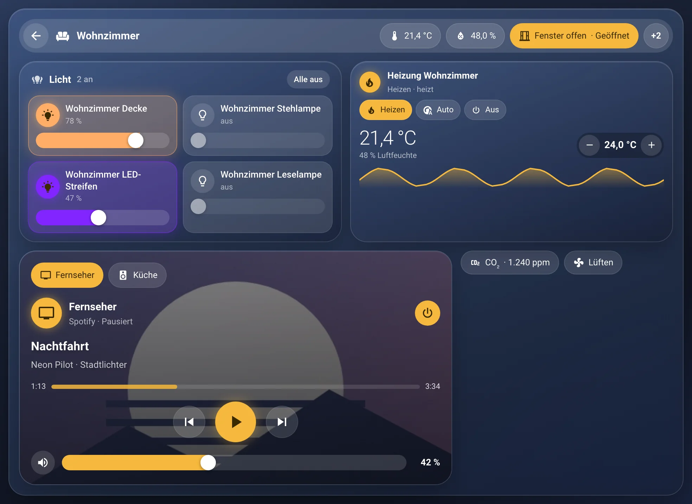
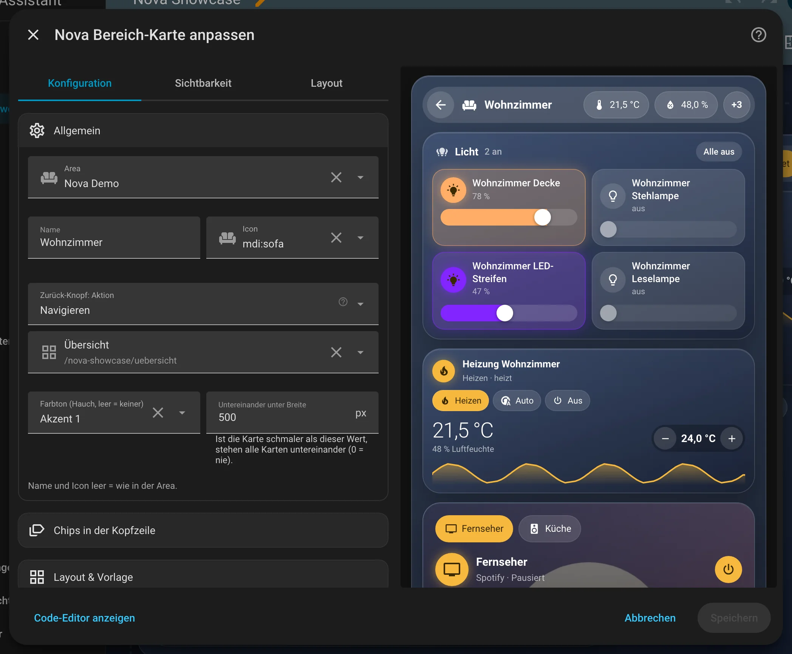
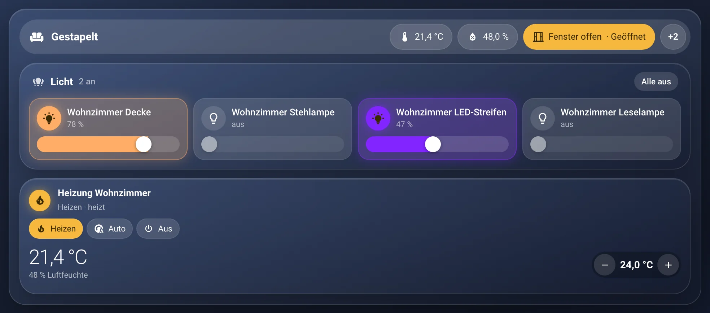

# Nova Bereich Card

[← Zurück zur Übersicht](../README.md)

<p align="center"></p>

Eine Raumansicht als großer Glasrahmen: oben eine Kopfzeile mit Zurück-Knopf, Icon und Raumname, darunter beliebige
Karten in Zeilen und Spalten – genau wie in der Nova Pop-up Card, nur fest im Dashboard. Rechts neben dem Raumnamen
sitzen auf Wunsch Chips (Werte oder Knöpfe wie „Alle Lichter im Raum aus“) – derselbe Baustein wie in der
[Nova Chips Card](chips-card.md), die es zusätzlich als eigene Karte für das Raster gibt. Gedacht für Raum-Unteransichten (z. B. `/zuhause/wohnzimmer`).

## Einrichtung

Am einfachsten über den grafischen Editor: Dashboard bearbeiten → **Karte hinzufügen** → nach „Nova“ suchen. Alle Optionen lassen sich dort einstellen, die Vorschau rechts zeigt das Ergebnis sofort.

<p align="center"></p>

## Anlegen

1. Dashboard bearbeiten → **Karte hinzufügen** → **Nova Bereich Card**.
2. Unter **Allgemein** die **Area** wählen. Name und Icon kommen aus der Area, beides lässt sich überschreiben.
3. Unter **Layout & Vorlage** eine Vorlage wählen und unter **Inhalt** die Plätze mit Karten füllen
   (Kartenauswahl von Home Assistant, danach der normale Karteneditor der gewählten Karte).

Die Karte nimmt im Abschnitt immer die volle Breite ein. Am besten in einer Ansicht vom Typ „Abschnitte“ mit nur
einem Abschnitt bzw. in einer Panel-Ansicht verwenden.

## Kopfzeile

| Option | Bedeutung |
|---|---|
| `area` | Area, aus der Name und Icon kommen |
| `name`, `icon` | Eigener Name / eigenes Icon (leer = wie in der Area). Ein zu langer Name läuft langsam hin und her statt umzubrechen |
| `back_action` | Aktion des Zurück-Knopfs. Ohne Angabe eine Seite zurück, `action: none` blendet den Knopf aus |
| `tint` | Farbton des Rahmens als Nova-Farbrolle (`neutral`, `accent-1` … `accent-4`), leer = keiner. Nur ein Hauch (7 %) über dem Rahmen, Karten darin bleiben in der Theme-Farbe |

## Chips in der Kopfzeile

| Option | Bedeutung |
|---|---|
| `chips` | Liste der Chips, gleiche Optionen wie in der [Nova Chips Card](chips-card.md#optionen-je-chip). Standard: keine |

Die Kopfzeile hat immer dieselbe Höhe, Chips stehen einzeilig darin. Höchstens drei Chips sind direkt zu sehen, und nur so viele,
wie neben dem Namen Platz haben – der Rest steckt hinter einem „+X“-Chip, der sie beim Antippen unter der Leiste aufklappt.
Der Name nimmt den übrigen Platz und läuft nur dort durch. (Die frühere Option `chips_layout` wird ignoriert.)

„Alle Lichter im Raum aus“ schaltet die Lichter der gewählten `area` aus. Auf dem Handy zeigen Chips mit Icon nur das
Icon (Wert-Chips Icon und Wert).

## Raster

Wie bei der Pop-up Card: `rows` ist eine Liste von Zeilen, jede Zeile hat `cells` mit je einer Karte (`card`) und
optional einer Breite (`width`: `1/4`, `1/3`, `1/2`, `2/3`, `3/4`, `1`; ohne Angabe teilen sich die Spalten den Platz).
Ohne Karten (`rows: []`) zeigt die Karte nur die Kopfzeile – praktisch als Titelleiste mit Zurück-Knopf über einer anderen Karte.

Mit `equal_height: true` („Gleiche Höhe pro Reihe“, Standard aus) werden alle Karten einer Zeile so hoch wie die höchste. Ist die Karte schmaler als `stack_below` (Standard 500 px, 0 = nie),
stehen alle Karten untereinander.

## Beispiel

```yaml
type: custom:nova-area-card
area: wohnzimmer
back_action:
  action: navigate
  navigation_path: /zuhause/home
chips:
  - type: button
    preset: lights_off
rows:
  - cells:
      - card:
          type: custom:nova-chips-card
          area: wohnzimmer
          chips:
            - entity: sensor.wohnzimmer_temperatur
            - type: button
              preset: lights_off
  - cells:
      - width: 1/2
        card:
          type: custom:nova-light-card
          area: wohnzimmer
      - card:
          type: custom:nova-thermostat-card
          entity: climate.wohnzimmer_heizung
  - cells:
      - card:
          type: custom:nova-media-card
```

## Zustände

<table>
<tr><td align="center" width="50%"><br><sub>Standard</sub></td><td align="center" width="50%"><br><sub>Gestapelt</sub></td></tr>
</table>

