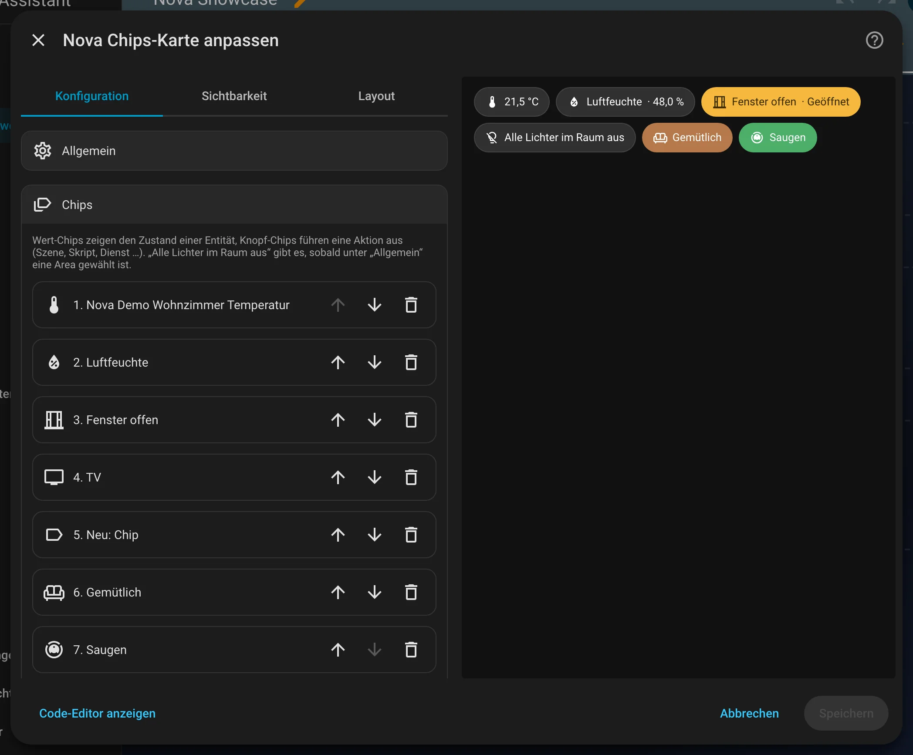

# Nova Chips Card

[← Zurück zur Übersicht](../README.md)

<p align="center"></p>

Eine Reihe frei belegbarer Chips. Jeder Chip ist entweder ein **Wert-Chip** (zeigt den Zustand einer Entität) oder ein
**Knopf-Chip** (führt eine Aktion aus). Alles lässt sich im grafischen Editor einstellen, Standard ist: keine Chips.

## Einrichtung

Am einfachsten über den grafischen Editor: Dashboard bearbeiten → **Karte hinzufügen** → nach „Nova“ suchen. Alle Optionen lassen sich dort einstellen, die Vorschau rechts zeigt das Ergebnis sofort.

<p align="center"></p>

## Optionen der Karte

| Option | Bedeutung |
|---|---|
| `chips` | Liste der Chips (siehe unten), Reihenfolge im Editor per Pfeil änderbar |
| `layout` | `wrap` (umbrechen, Standard) oder `scroll` (waagrecht scrollen) |
| `size` | `normal` (Standard) oder `large`: höhere Chips, die die Zeile gleichmäßig füllen – für kleine Touch-Displays wie den Echo Show |
| `area` | Nur für die Schnellauswahl „Alle Lichter im Raum aus“ nötig |

## Optionen je Chip

| Option | Bedeutung |
|---|---|
| `type` | `value` (Wert, Standard) oder `button` (Knopf) |
| `entity` | Wert-Chip: die angezeigte Entität. Knopf-Chip: optional, für Aktionen wie „Umschalten“ und für `state` |
| `name`, `icon` | Eigener Name / eigenes Icon. Wert-Chips ohne Name zeigen nur den Zustand |
| `decimals` | Nur Wert-Chips mit Zahl: feste Nachkommastellen im Zahlenformat des HA-Profils, z. B. `1` → „21,9 °C“. Leer = wie HA es anzeigt |
| `color` | Farbrolle (`neutral`, `accent-1` … `accent-4`), leer = neutral |
| `tap_action` | Aktion über die HA-Aktionsauswahl (Dienst, Szene, Skript, Navigation …). Wert-Chips ohne Aktion öffnen die Details |
| `preset` | Nur Knopf-Chips: Schnellauswahl statt eigener Aktion. `lights_off` = alle Lichter der gewählten Area aus |
| `state` | Nur anzeigen, wenn `entity` diesen Zustand hat (mehrere mit Komma, z. B. `on`) |

## Beispiel

```yaml
type: custom:nova-chips-card
area: wohnzimmer
chips:
  - entity: sensor.wohnzimmer_temperatur
    icon: mdi:thermometer
  - entity: binary_sensor.wohnzimmer_fenster
    name: Fenster offen
    color: accent-2
    state: "on"
  - type: button
    preset: lights_off
  - type: button
    name: Gemütlich
    icon: mdi:sofa
    tap_action:
      action: perform-action
      perform_action: scene.turn_on
      target:
        entity_id: scene.wohnzimmer_gemutlich
```

## Zustände

<table>
<tr><td align="center" width="50%"><br><sub>Standard</sub></td><td align="center" width="50%"><br><sub>Farbrollen</sub></td></tr>
</table>

