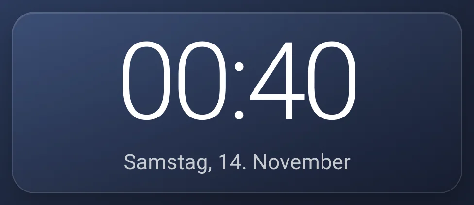
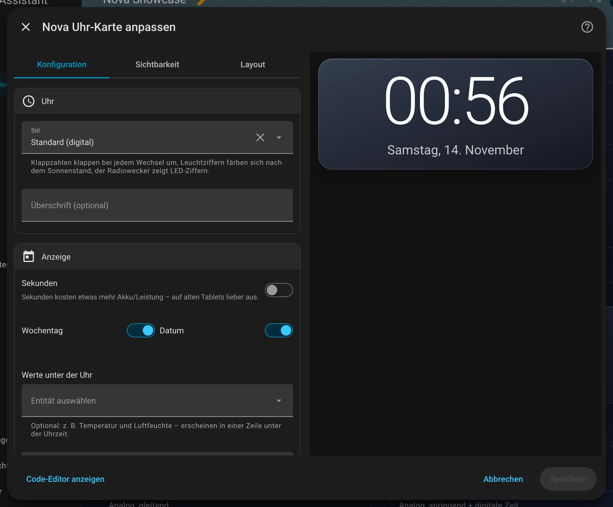
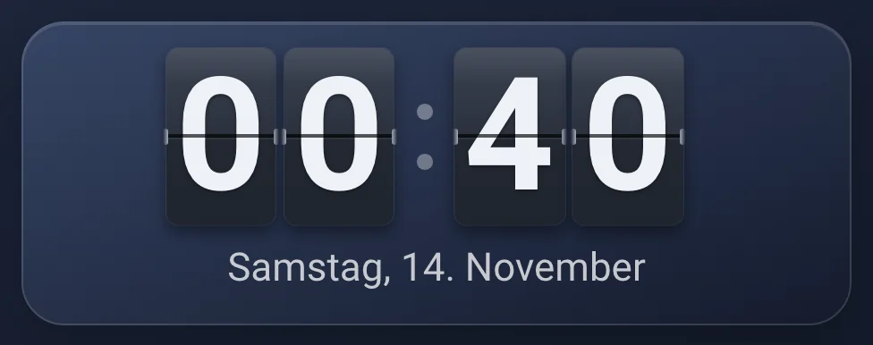
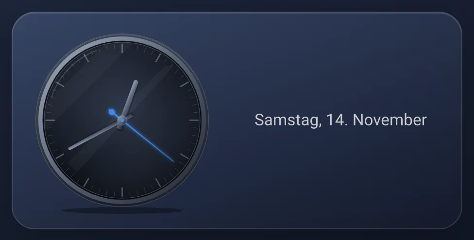
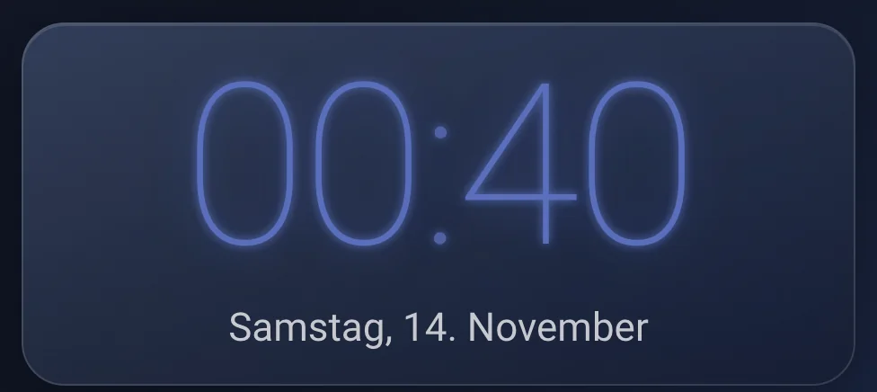

# Nova Uhr Card

[← Zurück zur Übersicht](../README.md)

<p align="center"></p>

Uhrzeit im Nova-Stil in fünf Stilen: digital mit großen, schlanken Ziffern wie die Uhr der Wetter Card, als Klappzahl-Uhr,
analog als Zifferblatt mit Chromring und Glas, als Leuchtziffern mit Farbe nach Sonnenstand oder als Radiowecker. Wochentag,
Datum und Werte auf Wunsch darunter. Die Größe passt sich der Karte an und läuft nie über. Sprache und 12/24 Stunden kommen aus deinem Home-Assistant-Profil, die Zeitzone ist immer die von Home Assistant.

## Einrichtung

Am einfachsten über den grafischen Editor: Dashboard bearbeiten → **Karte hinzufügen** → nach „Nova“ suchen. Alle Optionen lassen sich dort einstellen, die Vorschau rechts zeigt das Ergebnis sofort.

<p align="center"></p>

## Wenn du einfach nur eine Uhr willst, dann so

Dashboard bearbeiten → Karte hinzufügen → „Nova Uhr Card“. Mehr braucht es nicht, es gibt nichts auszuwählen.

```yaml
type: custom:nova-clock-card
```

## Wenn du eine Klappzahl-Uhr wie am Bahnhof willst, dann so

Im Editor „Stil“ auf „Klappzahlen“ stellen. Bei jedem Wechsel klappt die obere Hälfte der Ziffer um (600 ms) – nur die
Ziffern, die sich ändern. Gezeigt werden nur Stunden und Minuten.

```yaml
type: custom:nova-clock-card
style: flip
```

## Wenn du ein Zifferblatt willst, dann so

Im Editor „Stil“ auf „Analog“ stellen. Der Sekundenzeiger läuft in deiner Akzentfarbe gleitend (`sweep`), springt jede
Sekunde (`tick`) oder fehlt ganz (`none`).

```yaml
type: custom:nova-clock-card
style: analog
second_hand: sweep
```

## Wenn die Uhr mit dem Tag die Farbe wechseln soll, dann so

Stil „Leuchtziffern“: große, dünne Ziffern mit Leuchten. Die Farbe folgt dem Sonnenstand aus `sun.sun` – vor
Sonnenaufgang nachtblau, morgens warm, mittags weiß, abends tiefblau. Die Übergänge laufen fließend.

```yaml
type: custom:nova-clock-card
style: glow
```

## Wenn du einen Radiowecker willst, dann so

Stil „Radiowecker“: LED-Ziffern im Sieben-Segment-Stil, ausgeschaltete Segmente schimmern leicht durch, der Doppelpunkt
blinkt. Farbe der Ziffern: Rot, Grün, Blau oder Bernstein.

```yaml
type: custom:nova-clock-card
style: retro
retro_color: amber
```

## Wenn du nur die Uhrzeit ohne Datum willst, dann so

```yaml
type: custom:nova-clock-card
show_weekday: false
show_date: false
```

## Wenn Temperatur und Luftfeuchte klein unter der Uhr stehen sollen, dann so

Im Editor unter „Anzeige“ bei „Werte unter der Uhr“ die Sensoren auswählen. Sie erscheinen als dezente Zeile mit Icon.

```yaml
type: custom:nova-clock-card
show_weekday: false
show_date: false
entities:
  - sensor.kuche_temperatur
  - sensor.kuche_luftfeuchtigkeit
```

## Wenn die Uhr kleiner oder größer sein soll, dann so

Im Editor unter „Aussehen“ die „Größe“ wählen: Klein, Mittel (Standard) oder Groß. Wochentag, Datum und Werte wachsen mit.
Für eine ganz bestimmte Größe trägst du bei „Schriftgröße“ einen festen Wert ein, z. B. `48px` oder `3rem` – der hat Vorrang.

```yaml
type: custom:nova-clock-card
size: small
```

```yaml
type: custom:nova-clock-card
font_size: 3rem
```

Hat die Karte eine feste Höhe (z. B. `grid_options: rows: 2` im Abschnitts-Layout), passt sich die Uhr automatisch an:
Sie wird so weit kleiner, dass nie etwas über die Karte läuft. Karten mit automatischer Höhe bleiben, wie sie sind.

## Wenn Wochentag und Datum größer oder kleiner sein sollen als die Uhrzeit, dann so

Im Editor unter „Aussehen“ bei „Größe von Wochentag und Datum“ Klein, Mittel oder Groß wählen – oder einen eigenen Wert wie
`18px` oder `1.2rem` eintippen. Das gilt nur für Wochentag und Datum, die Uhrzeit bleibt, wie sie ist. Bei fester Kartenhöhe
wird trotzdem alles zusammen so eingepasst, dass nichts übersteht – auch bei `style: flip` und `layout: row`.
Dort steht auch das Datumsformat, z. B. „8. November“ (`long`) oder „8. November 2026“ (`long_year`).

```yaml
type: custom:nova-clock-card
style: flip
date_size: large
date_format: long
```

## Wenn die Karte breit und flach ist, dann so

In einer breiten, flachen Karte stehen Uhrzeit und Datum automatisch nebeneinander – die Uhrzeit links so hoch wie die Karte,
Überschrift, Datum und Werte rechts daneben. Das passiert nur, wenn untereinander nicht alles passt. Mit „Anordnung“ legst du
es fest: `stacked` (immer untereinander) oder `row` (immer nebeneinander).

```yaml
type: custom:nova-clock-card
layout: row
grid_options:
  columns: 30
  rows: 2
```

## Wenn die Uhr ohne Kartenhintergrund auf dem Dashboard stehen soll, dann so

```yaml
type: custom:nova-clock-card
glass: false
```

## Alle Optionen

| Option | Standard | Bedeutung |
|---|---|---|
| `style` | `default` | `default` (digital), `flip` (Klappzahlen), `analog`, `glow` (Leuchtziffern), `retro` (Radiowecker) |
| `second_hand` | `sweep` | Nur `style: analog`: `sweep` (gleitend), `tick` (springend) oder `none` |
| `retro_color` | `red` | Nur `style: retro`: `red`, `green`, `blue` oder `amber` |
| `sun_entity` | `sun.sun` | Nur `style: glow`: Sonne für die Farbe. Fehlt sie, wird der Sonnenstand aus der Uhrzeit geschätzt |
| `mode` | `digital` | Alte Schreibweise: `mode: analog` entspricht `style: analog` mit Sekundenzeiger über `show_seconds` |
| `name` | – | Kleine Überschrift über der Uhr, z. B. „Küche“ |
| `show_seconds` | `false` | Sekunden anzeigen (digital und Radiowecker klein hinter der Zeit; nicht bei Klappzahlen) |
| `analog_digital` | `false` | Nur analog: zusätzlich die digitale Zeit neben dem Zifferblatt |
| `show_weekday` | `true` | Wochentag |
| `show_date` | `true` | Datum |
| `entities` | – | Werte unter der Uhr, z. B. Temperatur und Feuchte. Einträge als Entität oder `{entity, name, icon, unit, decimals}` |
| `date_format` | `long` | `long` (2. November), `long_year` (2. November 2026), `short` (2. Nov.) oder `numeric` (02.11.2026) |
| `time_format` | `auto` | `auto` (wie im Profil), `24` oder `12` |
| `color` | `accent-1` | Farbrolle für den Sekundenzeiger der analogen Uhr |
| `glass` | `true` | Glas-Hintergrund der Karte |
| `size` | `medium` | Größe der Uhr: `small`, `medium` oder `large`. Datum, Wochentag und Werte wachsen mit |
| `font_size` | – | Feste Schriftgröße der Uhrzeit, z. B. `48px` oder `3rem` (Zahl = px). Hat Vorrang vor `size` |
| `date_size` | `medium` | Größe von Wochentag und Datum, unabhängig von der Uhrzeit: `small`, `medium`, `large` oder ein Wert wie `18px` / `1.2rem` |
| `layout` | `auto` | `auto` (in flachen Karten nebeneinander, wenn untereinander nicht passt), `stacked` (untereinander) oder `row` (nebeneinander). Analog hat sein eigenes Layout |
| `tap_action`, `hold_action` | – | Aktion beim Antippen bzw. langen Drücken |

Theme-Variablen: `--nova-clock-morning`, `--nova-clock-noon`, `--nova-clock-night` – Farben der Leuchtziffern.
`--nova-led-red`, `--nova-led-green`, `--nova-led-blue`, `--nova-led-amber` – LED-Farben des Radioweckers. `--nova-clock-size` – Schriftgröße der digitalen Zeit bzw. größte Breite des Zifferblatts. `--nova-clock-info-size` – Schriftgröße der Werte-Zeile unter der Uhr (Standard passt sich der Kartenbreite an, 14–26 px).

## Gut zu wissen

- Die Uhr hat genau einen Zeitgeber. Er feuert nur zum nächsten Minutenwechsel (mit Sekunden: Sekundenwechsel) und nur,
  solange die Karte zu sehen ist. Wird die Karte entfernt oder der Tab versteckt, läuft nichts weiter.
- Der gleitende Sekundenzeiger läuft als Animation ohne Zeitgeber. Ist „Bewegung reduzieren“ eingestellt, springt er stattdessen.
- Die Zeit kommt vom Gerät, auf dem das Dashboard läuft, angezeigt in der Zeitzone von Home Assistant. Geht die Uhr des Geräts falsch, geht auch die Karte falsch.

## Zustände

<table>
<tr><td align="center" width="50%"><br><sub>Digital</sub></td><td align="center" width="50%"><br><sub>Klappzahlen</sub></td></tr>
<tr><td align="center" width="50%"><br><sub>Analog</sub></td><td align="center" width="50%"><br><sub>Leuchtziffern</sub></td></tr>
</table>

