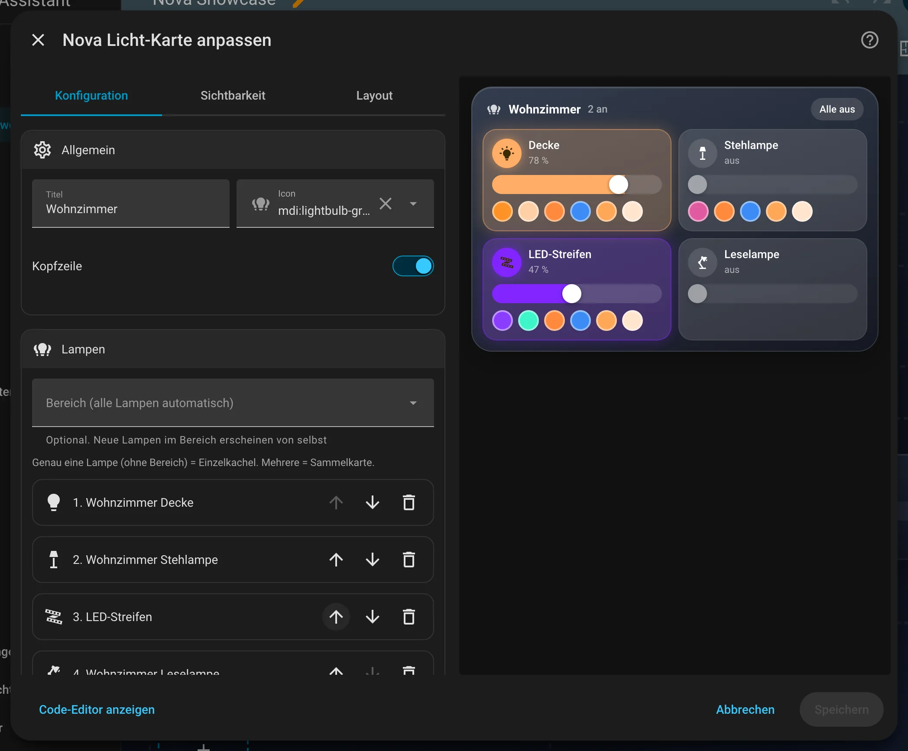

# Nova Licht Card

[← Zurück zur Übersicht](../README.md)

<p align="center"></p>

Lampen als Kacheln: Antippen schaltet, Regler dimmt, Kachel leuchtet in der Lichtfarbe. Eine Lampe = Einzelkachel, mehrere = Sammelkarte.

## Einrichtung

Am einfachsten über den grafischen Editor: Dashboard bearbeiten → **Karte hinzufügen** → nach „Nova“ suchen. Alle Optionen lassen sich dort einstellen, die Vorschau rechts zeigt das Ergebnis sofort.

<p align="center"></p>

```yaml
type: custom:nova-light-card
title: Wohnzimmer
area: wohnzimmer          # alle Lampen im Bereich automatisch
exclude:
  - light.wohnzimmer_nachtlicht
colors: ['#ff8a3d', k2700] # Farbknöpfe für alle Lampen (kXXXX = Weißton in Kelvin)
entities:
  - entity: light.stehlampe
    name: Stehlampe
    colors: ['#3d8bf5']
```

| Option | Standard | Bedeutung |
|---|---|---|
| `entities` / `area` | – | Lampen (mindestens eins von beiden) |
| `exclude` | – | Ausblenden bei `area` |
| `hide_group_members` | `true` | Bei `area`: Ist eine Lichtgruppe dabei (z. B. Deckenlampen), erscheinen ihre Mitglieder nicht zusätzlich. Eingetragene Lampen bleiben immer. |
| `strip_area_name` | `true` | Raumnamen aus den Lampennamen entfernen („Wohnzimmer Pilzlampe“ → „Pilzlampe“). Eigene Namen bleiben. Lange Namen brechen um. |
| `show_header` / `show_all_off` | `true` | Kopfzeile, „Alle aus“ |
| `use_light_color` | `true` | In Lichtfarbe leuchten |
| `show_colors` / `colors` | `true` / – | Farbknöpfe (im Editor per Farbscheibe anlegen) |

Je Lampe unter `entities` (statt nur der Entity-ID): `entity`, `name`, `icon`, `colors`, `tap_action`, `hold_action` und
`slider: false` – dann hat die Kachel keinen Helligkeitsregler und wird flacher (praktisch für kleine Displays wie den Echo Show).

## Zustände

<table>
<tr><td align="center" width="50%"><br><sub>Sammelkarte</sub></td><td align="center" width="50%"><br><sub>An</sub></td></tr>
<tr><td align="center" width="50%"><br><sub>Aus</sub></td></tr>
</table>

