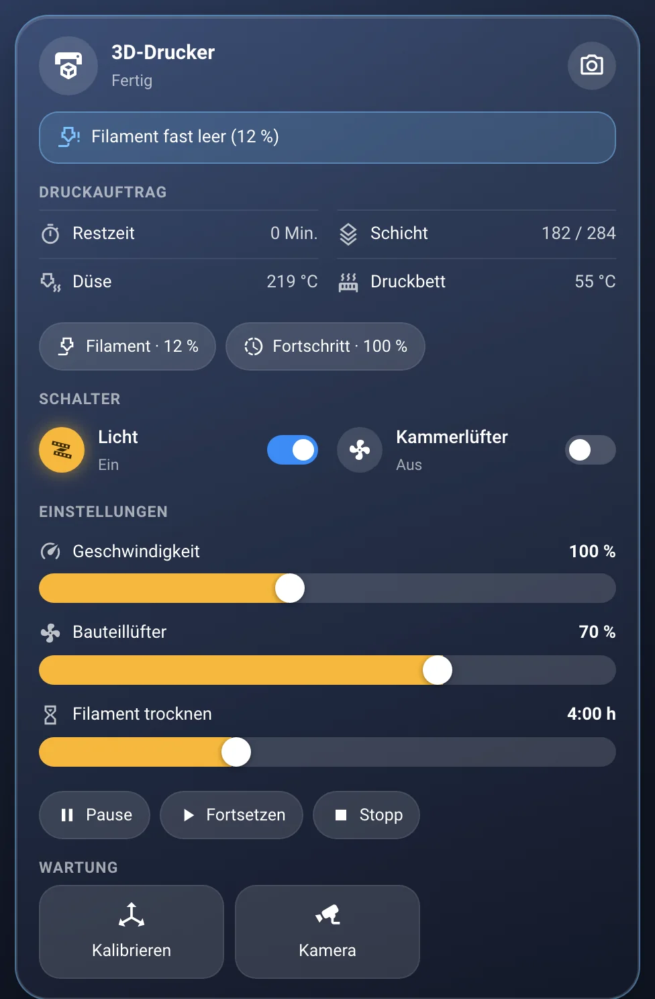
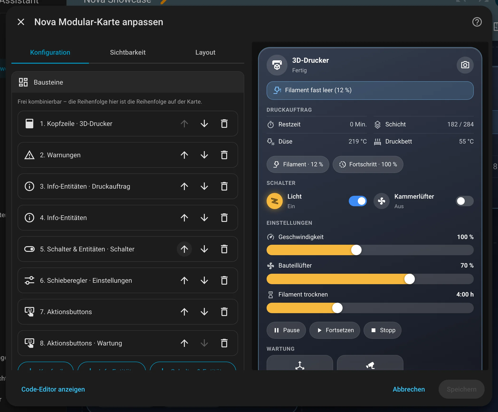
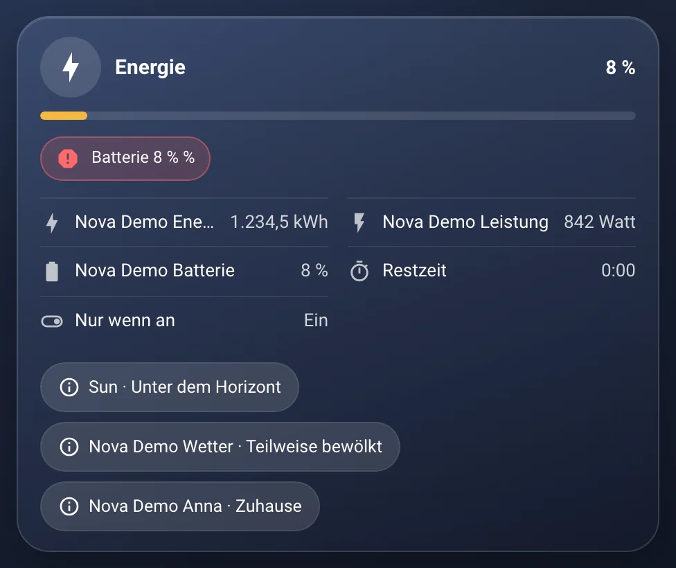

# Nova Modular Card

[← Zurück zur Übersicht](../README.md)

<p align="center"></p>

Gerätekarte aus frei kombinierbaren Bausteinen – z. B. Futterautomat, Airfryer, Katzenklo. Im Editor Bausteine hinzufügen, sortieren und löschen.

## Einrichtung

Am einfachsten über den grafischen Editor: Dashboard bearbeiten → **Karte hinzufügen** → nach „Nova“ suchen. Alle Optionen lassen sich dort einstellen, die Vorschau rechts zeigt das Ergebnis sofort.

<p align="center"></p>

```yaml
type: custom:nova-modular-card
blocks:
  - type: header
    name: Airfryer
    icon: mdi:chef-hat
    status: sensor.airfryer_kochstatus
    progress: sensor.airfryer_fortschritt
    button_icon: mdi:cog
    button_action:
      action: more-info
  - type: alerts
    alerts:
      - entity: binary_sensor.futterautomat_food_level
        message: Futterstand niedrig
      - entity: sensor.airfryer_fehlercode
        state_not: "0"
        level: error
  - type: info
    entities:
      - entity: sensor.airfryer_verbleibende_zeit
        name: Verbleibend
      - entity: sensor.futterautomat_dispensed
        decimals: 0
        unit: g
  - type: entities
    columns: 2
    entities:
      - switch.airfryer_stromversorgung
  - type: sliders
    entities:
      - entity: number.airfryer_temperatur
      - entity: number.airfryer_kochzeit
        format: duration
  - type: buttons
    layout: grid
    buttons:
      - entity: button.airfryer_start
        name: Start
        icon: mdi:play
      - name: Reinigung erledigt
        icon: mdi:check-circle
        confirm: Wirklich erledigt?
        tap_action:
          action: perform-action
          perform_action: script.turn_on
          target:
            entity_id: script.katzenklo_reinigung_bestaetigen
```

| Baustein | Optionen |
|---|---|
| `header` | `name`, `icon`, `status` (Text + an/aus), `active` (statt `status` für an/aus), `progress` (%-Balken), `tap_action`, `button_icon` + `button_action` (Touch-Button oben rechts) |
| `info` | `entities[]`: `entity`, `name`, `icon`, `unit`, `decimals`, `format: value\|clock` (`clock` = Dauer als m:ss, z. B. Restzeit), `hide_idle` (Zeile nur, solange der Wert nicht 0/aus ist), `tap_action` · `layout: rows\|chips`, `columns` |
| `entities` | `entities[]`: `entity`, `name`, `icon`, `tap_action`, `hold_action`, `confirm` · `columns`. Standard: schalten, sonst more-info |
| `sliders` | `entities[]`: `entity` (number, input_number, light, fan, cover, media_player, climate, water_heater), `name`, `icon`, `min`/`max`/`step`, `unit`, `format: duration` (Minuten → Std:Min) |
| `buttons` | `buttons[]`: `name`, `icon`, `entity` (button/script/scene werden ausgelöst) oder `tap_action`, `confirm` · `layout: pills\|flat\|grid` (`flat` = flache Knöpfe nebeneinander, spart Höhe) |
| `alerts` | `alerts[]`: `entity`, `state` / `state_not` (Komma-Liste), `above` / `below`, `message` (`{state}` wird ersetzt), `icon`, `level: warning\|error\|info` · `layout: list\|chips`, `glow` (Kartenrahmen, Standard `true`) |

Für die ganze Karte: `size` (Größe in Prozent, Standard `100`, z. B. `150` für Wandpanels) – skaliert Schrift, Icons und Abstände.

Alle Bausteine außer `header` haben optional `title`. Einträge dürfen auch als Kurzform `- sensor.xyz` angegeben werden.

## Zustände

<table>
<tr><td align="center" width="50%"><br><sub>Standard</sub></td><td align="center" width="50%"><br><sub>Info</sub></td></tr>
</table>

