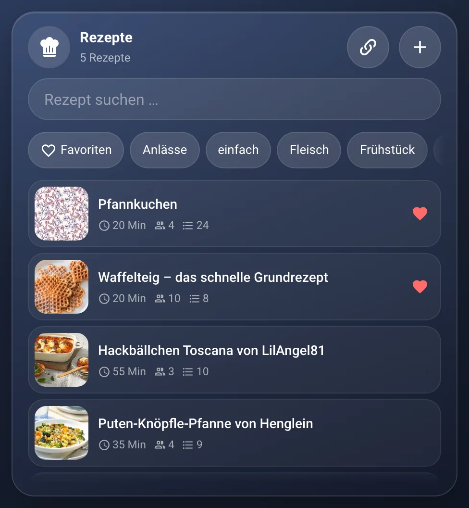
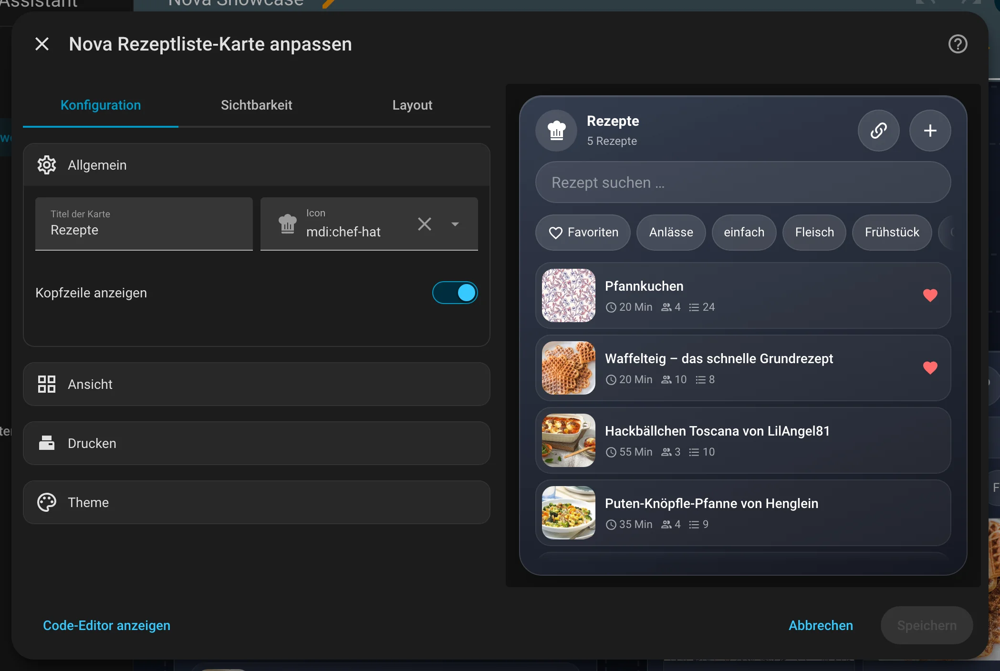
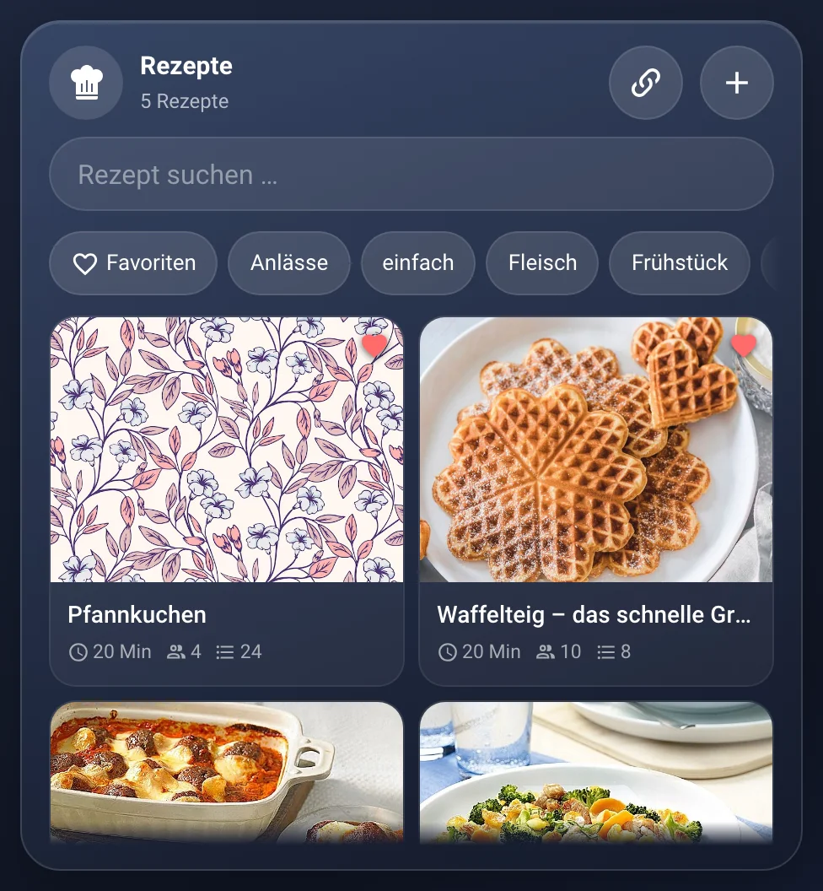

# Nova Rezeptliste

[← Zurück zur Übersicht](../README.md)

<p align="center"></p>

Kompakte Rezeptliste, schnell durchsuchbar und auf allen Geräten gleich. Dieselben Rezepte zeigt das
[Nova Rezeptbuch](rezeptbuch-card.md) zum Blättern. Die Daten liegen in der
[Nova-Integration](https://github.com/Blackstar9119/nova-integration) (Modul „Rezeptbuch“) – ohne sie zeigt die Karte nur einen Hinweis.

- **Liste:** Suche (Name, Schlagwort, Zutat), Schlagwörter und Favoriten als Filter-Chips, Favoriten stehen oben.
- **Rezept:** Bild, Zeit, Schlagwörter, Zutaten und Zubereitung. Mit + / – rechnest du die **Portionen** um, die Mengen
  ändern sich sofort. Checklisten in der Zubereitung lassen sich beim Kochen abhaken (das Rezept bleibt unverändert).
- **Auf die Einkaufsliste:** Zutaten an- oder abwählen und den Knopf darunter antippen – sie landen umgerechnet in der
  Nova Einkauf Card. Steht eine Zutat dort schon offen (gleiche Einheit), wird die Menge erhöht. Einheiten, die es beim
  Einkauf nicht gibt (TL, Prise, Bund …), kommen als 1 Stück auf die Liste.
- **Bearbeiten:** Stift oben rechts. Name, Portionen, Zeit, Schlagwörter, Bild (wird vor dem Speichern verkleinert),
  Zutaten (Menge, Einheit, Name) und die Zubereitung mit Formatierung. Gespeichert wird automatisch, sobald das Rezept
  einen Namen hat. Löschen: Mülleimer, zweimal tippen.
- **Rezept importieren** (Kettensymbol oben): Link einfügen, z. B. von Chefkoch. Die Nova-Integration liest die Seite
  (schema.org-Rezeptdaten) und füllt eine Vorschau mit Titel, Portionen, Zeit, Zutaten mit Menge und Einheit, Schritten
  und Bild. Alles lässt sich ändern; gespeichert wird erst mit „Übernehmen“, das Kreuz verwirft die Vorschau. Gibt es das
  Rezept schon (gleicher Link oder Titel), fragt die Karte: ersetzen oder trotzdem neu. Findet die Integration kein Rezept
  auf der Seite, bietet die Karte an, es selbst anzulegen. Unter importierten Rezepten steht die Quelle als Link.

## Einrichtung

Am einfachsten über den grafischen Editor: Dashboard bearbeiten → **Karte hinzufügen** → nach „Nova“ suchen. Alle Optionen lassen sich dort einstellen, die Vorschau rechts zeigt das Ergebnis sofort.

<p align="center"></p>

```yaml
type: custom:nova-recipe-card
view: grid
print_script: script.notiz_drucken
```

| Option | Standard | Bedeutung |
|---|---|---|
| `name`, `icon` | `Rezepte`, `mdi:chef-hat` | Kopfzeile |
| `show_header` | `true` | Kopfzeile mit Anzahl und Plus-Knopf |
| `view` | `list` | `list` = eine Zeile je Rezept · `grid` = Kacheln mit großem Bild |
| `show_search` | `true` | Suchfeld anzeigen |
| `height` | `420` | Mindesthöhe in px; im Raster füllt die Karte den Platz aus |
| `print_script` | – | Skript für den Druck-Knopf im geöffneten Rezept (leer = kein Knopf) |
| `print_field` | `text` | Feldname, unter dem das Skript das Rezept als Klartext bekommt |
| `print_label`, `print_icon` | `Drucken`, `mdi:printer-pos` | Titel und Icon des Knopfs |

## Drucken

Das Skript bekommt das Rezept als Klartext – mit den gerade eingestellten Portionen:

```
PFANNKUCHEN
4 Portionen · 20 Min

ZUTATEN
[ ] 500 g Mehl
[ ] 1000 ml Milch

ZUBEREITUNG
[ ] Mehl, Milch, Eier und Salz glatt rühren
```

Das Druck-Skript der [Notiz Card](notiz-card.md#drucken) passt unverändert.

## Zustände

<table>
<tr><td align="center" width="50%"><br><sub>Liste</sub></td><td align="center" width="50%"><br><sub>Kacheln</sub></td></tr>
</table>

