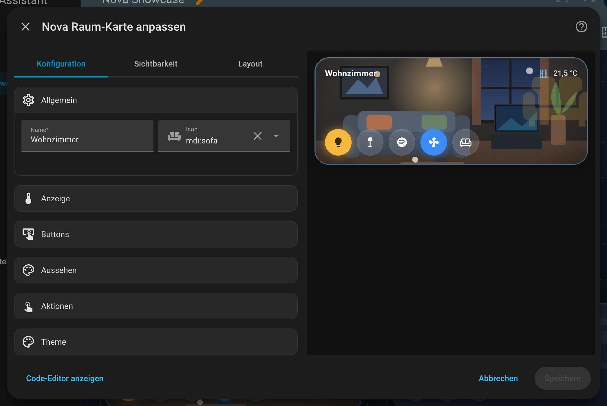
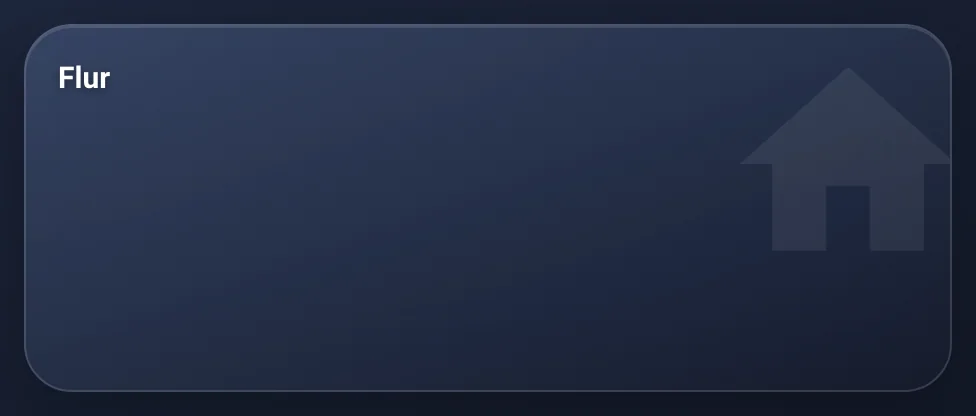

# Nova Raum Card

[← Zurück zur Übersicht](../README.md)

<p align="center"></p>

Raumkachel mit Temperatur, Fenster-Warnung und frei belegbaren runden Buttons. Leuchtet, wenn Licht im Raum an ist.

## Einrichtung

Am einfachsten über den grafischen Editor: Dashboard bearbeiten → **Karte hinzufügen** → nach „Nova“ suchen. Alle Optionen lassen sich dort einstellen, die Vorschau rechts zeigt das Ergebnis sofort.

<p align="center"></p>

```yaml
type: custom:nova-room-card
name: Wohnzimmer
icon: mdi:sofa
temperature: sensor.wohnzimmer_temperatur
windows:
  - binary_sensor.wohnzimmer_fenster
tap_action:
  action: navigate
  navigation_path: /dashboard/wohnzimmer
buttons:
  - entity: light.wohnzimmer_decke
  - entity: media_player.tv
    icon_entity: sensor.tv_app
    icon_map:
      netflix: /local/logos/netflix.svg
```

| Option | Bedeutung |
|---|---|
| `name`, `icon` | Titel und Hintergrund-Icon |
| `temperature` | Sensor oder Thermostat für die Anzeige oben rechts |
| `info` (+ `info_suffix`, `info_round`) | Andere Entität statt Temperatur |
| `windows` | Offen = farbiger Rahmen + Icon |
| `image` | Hintergrundbild, z. B. `/local/raeume/kueche.jpg` |
| `buttons[]` | `entity`, `icon`, `name`, `state_entity`, `tap_action`, `hold_action`, `icon_entity` + `icon_map` |

Antippen schaltet um (Szenen/Skripte/Buttons werden ausgelöst), lang drücken öffnet Details.

## Zustände

<table>
<tr><td align="center" width="50%"><br><sub>Standard</sub></td><td align="center" width="50%"><br><sub>Minimal</sub></td></tr>
</table>

