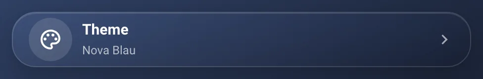
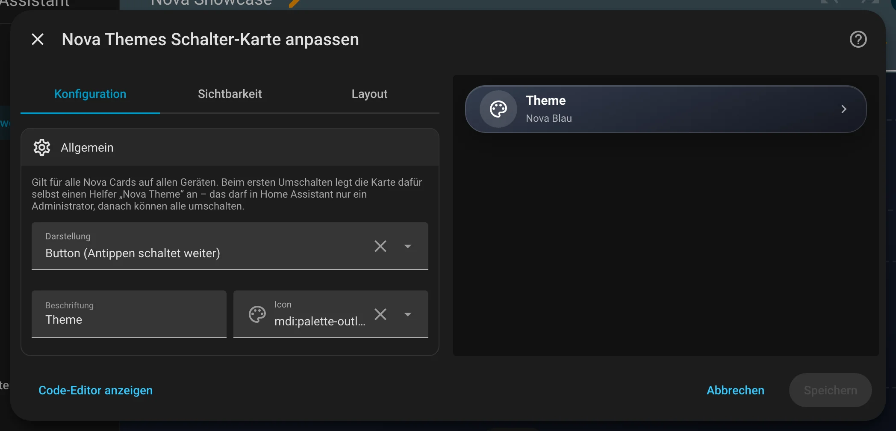
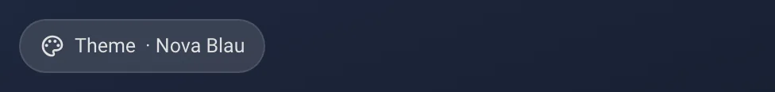
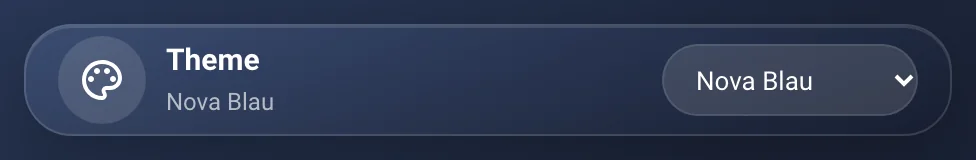

# Nova Themes Schalter

[← Zurück zur Übersicht](../README.md)

<p align="center"></p>

Wählt das Nova-Theme für **alle Nova Cards auf allen Geräten** – ein Fingertipp, kein Helfer, kein YAML, keine Theme-Variablen.
Themes: Nova Blau (Standard), Nova Hell, Nova Midnight und Nova Velvet.

## Einrichtung

Am einfachsten über den grafischen Editor: Dashboard bearbeiten → **Karte hinzufügen** → nach „Nova“ suchen. Alle Optionen lassen sich dort einstellen, die Vorschau rechts zeigt das Ergebnis sofort.

<p align="center"></p>

## Anlegen

Dashboard bearbeiten → Karte hinzufügen → „Nova Themes Schalter“. Beim ersten Umschalten legt die Karte selbst einen Helfer
„Nova Theme“ (`input_select.nova_theme`) an, in dem das Theme gespeichert wird. Das darf in Home Assistant nur ein Administrator:
Ist noch nichts eingerichtet, zeigt die Karte Nicht-Admins „Einmal als Admin umschalten“. Danach können alle umschalten.

## Optionen

| Option | Bedeutung |
|---|---|
| `display` | `button` (Standard, Antippen schaltet zum nächsten Theme), `chip` (wie die Chips Card, Antippen schaltet weiter) oder `dropdown` (Liste) |
| `name` | Beschriftung, Standard „Theme“ |
| `icon` | Icon, Standard `mdi:palette-outline` |

## Theme je Karte und je Gerät

- **Je Karte:** In jedem Karteneditor gibt es unten den Bereich „Theme“: „Global“ (Standard) folgt dem Schalter, ein festes Theme gilt
  nur für diese Karte – bei Pop-up, Bereich und Swipe auch für die Karten darin.
- **Je Gerät:** Im HA-Theme des Geräts die Variable `nova-theme: hell` bzw. `nova-theme: midnight` setzen (z. B. Midnight für den Echo Show am Bett). Das schlägt das globale Theme,
  aber nicht das Theme einer Karte.

## Beispiel

```yaml
type: custom:nova-theme-card
display: dropdown
```

## Zustände

<table>
<tr><td align="center" width="50%"><br><sub>Knopf</sub></td><td align="center" width="50%"><br><sub>Chip</sub></td></tr>
<tr><td align="center" width="50%"><br><sub>Liste</sub></td></tr>
</table>

