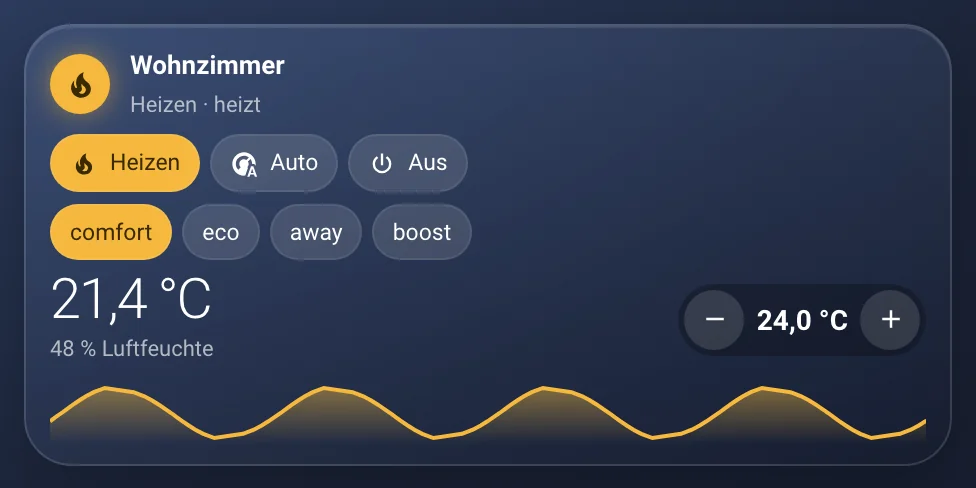
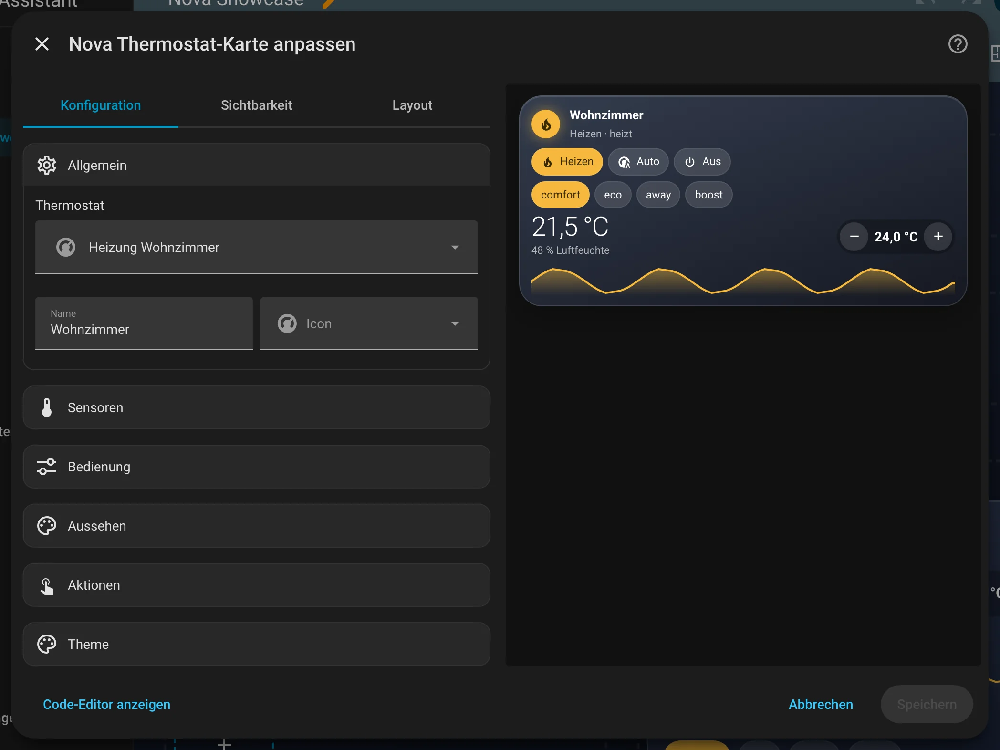
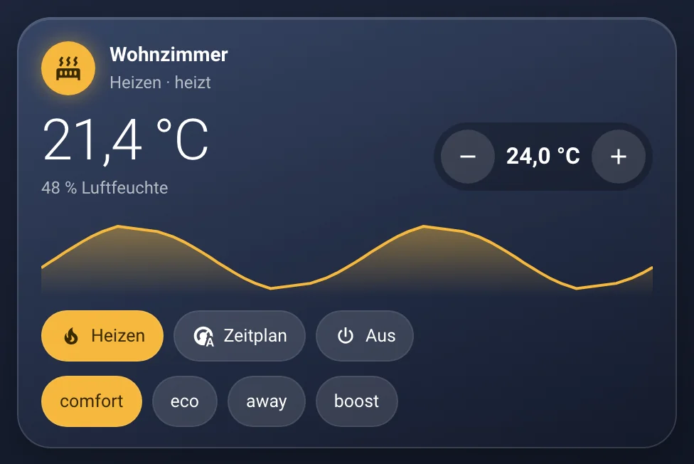

# Nova Thermostat Card

[← Zurück zur Übersicht](../README.md)

<p align="center"></p>

Ist-/Solltemperatur, ± Stepper, Verlauf, Modi und Presets.

## Einrichtung

Am einfachsten über den grafischen Editor: Dashboard bearbeiten → **Karte hinzufügen** → nach „Nova“ suchen. Alle Optionen lassen sich dort einstellen, die Vorschau rechts zeigt das Ergebnis sofort.

<p align="center"></p>

```yaml
type: custom:nova-thermostat-card
entity: climate.wohnzimmer
sensor: sensor.wohnzimmer_temperatur
windows:
  - binary_sensor.wohnzimmer_fenster
show_graph: true
graph_hours: 24
modes: [heat, auto, off]
```

| Option | Standard | Bedeutung |
|---|---|---|
| `entity` | – | Thermostat (Pflicht) |
| `sensor` | – | Genauerer Raumsensor für Anzeige & Verlauf |
| `humidity` | – | Luftfeuchte-Sensor |
| `show_graph` / `graph_hours` | `true` / `24` | Verlauf |
| `show_modes` / `modes` | `true` / alle | Modus-Knöpfe |
| `show_presets` | `false` | Preset-Knöpfe |
| `compact` | `true` | Kompaktes Layout |
| `step` | vom Gerät | Schrittweite ± |

## Zustände

<table>
<tr><td align="center" width="50%"><br><sub>Kompakt</sub></td><td align="center" width="50%"><br><sub>Groß</sub></td></tr>
</table>

